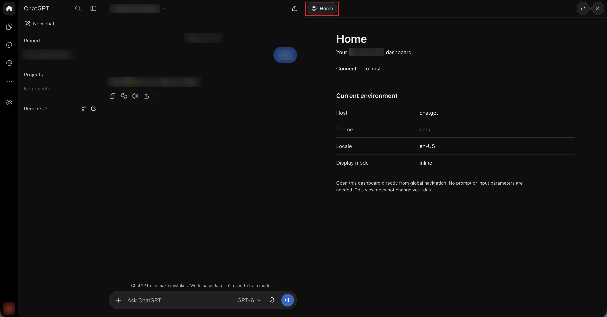

# ChatGPT拡張機能の設定 {#chatgpt-extensions}

>[!IMPORTANT]
>
>LLM Appsは、AEM Sites Cloud Serviceのすべてのユーザーが独自のアプリケーションを開発および管理できます。 メーター設定が開始されると、各アプリ呼び出しは、お客様のAEM Sites コンテンツリクエストにカウントされます。 Adobeは、計量が有効になる前に、計量レートと開始日を発表します。

**これらはChatGPT専用の拡張機能です。** [!DNL Claude]またはその他のLLM プラットフォームの機能は設定しません。 アプリは、標準のアクションとウィジェットを通じて、これらのプラットフォームで引き続き動作します。

**[!UICONTROL ChatGPT拡張機能]**&#x200B;を使用すると、ユーザーがアプリを直接開いたり、会話の横に置いたり、サポートされているファイルを表示したり、メッセージの作成中にアイテムを検索したりできます。

**このガイドでは、**&#x200B;これらのオプション機能を設定する方法と、ユーザーがオプション機能を使用する方法について説明します。 例えば、商品カタログがあります。アプリに必要な機能のみを有効にします。

スクリーンショットの赤いアウトラインは、手順で使用するコントロールをハイライト表示します。 これらはドキュメントの注釈であり、UI エラーインジケーターではありません。

## 始める前に {#before-you-begin}

次のものが必要です。

- 既存のLLM アプリ、そのアクションを編集する権限、およびタスクの作業アクション。
- 直接開いたり、ファイルを表示したりするための公開済みウィジェット。 テキストのみのアクションは、メンション検索を提供できますが、エントリーポイントは提供できません。
- `@adobe/llm-apps-runtime` 1.3.0と、ウィジェット機能については、`@adobe/llmapps-sdk` 0.2.1以降でサポートされているバージョンです。 アプリの管理者に、両方のバージョンを確認し、必要に応じて提供されたウィジェットスクリプトを更新するように依頼します。
- 接続されたアプリと、選択した拡張機能をサポートするクライアント。

>[!IMPORTANT]
>
>ご利用いただけるかどうかは、クライアントによって異なります。 ファイルのエントリポイントは&#x200B;**デスクトップ専用**&#x200B;です。コンポーザーのメンションには&#x200B;**デスクトップまたは作業ブラウザー**&#x200B;が必要です。 OpenAIのweb サポート列には、従来の[!DNL ChatGPT]が含まれていません。 テストする前に、[ プラットフォームのサポート ](https://github.com/openai/mcp-extensions/blob/main/docs/spec.md#platform-support)を確認してください。

>[!IMPORTANT]
>
>設定では、**not**&#x200B;がファイルビューアを作成したり、検索を実装したりします。 メンテナに必要な[action](/help/guides/customize-handler.md)と[widget](/help/guides/widgets.md)を最初に準備してもらいます。

## ChatGPT拡張機能を開く {#open-extensions}

1. アプリを開き、**[!UICONTROL アクション]**&#x200B;を選択します。
1. 設定するアクションを開きます。
1. 「**[!UICONTROL ChatGPT Extensions]**」タブを選択します。

このタブは、アクションの作成中にも使用できます。 このガイドでは、レビュー済みの既存のアクションを使用します。

編集後、**[!UICONTROL 変更を保存]**&#x200B;を選択します。 設定を公開するには、[ アプリをデプロイ ](/help/guides/deploy-your-app.md)し、[ChatGPT接続を更新](/help/guides/test-in-chatgpt.md#refresh-after-app-changes)します。

## アプリを開く場所を選択 {#configure-entrypoints}

**entrypoint**&#x200B;は、ユーザーがモデルに呼び出しを依頼せずにアプリを開く場所です。

>[!NOTE]
>
>同じウィジェットに複数のエントリポイントを選択できます。 エントリーポイントは、エントリーポイントを開くための追加の方法を提供します。通常のチャット呼び出しに代わるものではありません。 アクションがモデルで使用可能な場合でも、ユーザーはチャットでアクションを要求し、そのウィジェットを受け取ることができます。

1. **[!UICONTROL Entrypoints]**&#x200B;の下で、オプションで&#x200B;**[!UICONTROL アイコン URL]**&#x200B;にパブリック HTTPS イメージ URLを入力します。 アイコンは、このアクションのエントリポイントによって共有されます。公開が許可されている画像を使用してください。
1. **[!UICONTROL ユーザーがこのアプリを開くことができる場所]**&#x200B;で、同じウィジェットに対して次のチェックボックスの任意の組み合わせを選択します。 アクションを直接開く必要がない場合は、すべてのチェックを外します。

   | 種類 | 結果 |
   |---|---|
   | **[!UICONTROL グローバル]** | ナビゲーションからカタログの全画面を開く |
   | **[!UICONTROL スレッド]** | 会話の横にタブとしてカタログを開く |
   | **[!UICONTROL ファイル]** | 一致するファイルをカスタムビューアで開く |

1. グローバルまたはスレッドの場合は、アクションが必須の入力なしで機能することを確認します。
1. 「ファイル」で、以下の設定を完了します。

例えば、「グローバル」と「スレッド」の両方を選択して、ナビゲーションまたは会話の横から同じカタログウィジェットを開きます。 ウィジェットがファイル表示をサポートしている場合は、「ファイル」を選択することもできます。 ファイルをグローバルまたはスレッドと組み合わせる場合は、`file`入力の&#x200B;**[!UICONTROL Required]**&#x200B;をオフのままにします。ファイルの起動は引き続きファイルオブジェクトを提供しますが、グローバルおよびスレッドの起動は入力なしで行われます。 ハンドラーとウィジェットは両方のケースをサポートする必要があります。 ファイルのみのアクションには`file`が必要です。

が表示される

**期待される結果：** カタログをグローバルのナビゲーションから開くか、スレッドの会話側タブとして開きます。

### ナビゲーションまたは会話から開く {#test-global-thread}

次のユーザー指定のスクリーンショットは、カタログの例ではなく、**Home** ダッシュボードを示しています。 ナビゲーションとメニューの配置はクライアントによって異なります。

**グローバル**&#x200B;で、ナビゲーションメニューを開き、アプリのエントリーポイントを選択します。 この例では、エントリーポイントは&#x200B;**Home**&#x200B;です。

ダッシュボードがフルスクリーンで開き、ナビゲーションパネルが引き続き使用可能であることを確認します。

**スレッド**&#x200B;の場合、会話メニューを開き、**[!UICONTROL プラグイン]**&#x200B;を選択し、エントリポイントを選択します。 新しいプロンプトを必要とせずに、ウィジェットが会話の横に開くことを確認します。

### アプリでサポートされているファイルを開く {#file-entrypoint}

準備されたCSV カタログビューアの場合：

1. 「**[!UICONTROL ファイル]**」チェックボックスを選択し、**[!UICONTROL 拡張機能を追加]**&#x200B;を選択して、`.csv`と入力します。 サポートされている各拡張機能を独自のフィールドに追加します。
1. **[!UICONTROL アクションの詳細]** > **[!UICONTROL 入力パラメーター]**&#x200B;の下で、`name`と`resourceUri`を受け入れる`file`という名前の&#x200B;**Object** パラメーターを確認してください。 ファイルを選択すると、`file` パラメーターが存在しない場合はオプションのオブジェクト入力が追加されます。既存の定義を確認してください。 他の入力は必要ありません。 グローバルまたはスレッドが選択されている場合は、`file`をオプションのままにします。
1. サポートされているデスクトップクライアントで、機密性のない`.csv` ファイルをアプリで開きます。

**期待される結果：** ウィジェットにファイルが表示されます。 さらに編集を保存するには、編集サポートと書き込み可能なファイルを実装する必要があります。

>[!IMPORTANT]
>
>ファイルのエントリポイントは、アップロードされたファイルのパラメーターとは異なります。 アップロードダウンロード URLやファイル IDではなく、開いたファイル リソース参照を受け取ります。

## アプリの表示方法を選択 {#display-settings}

**[!UICONTROL 表示モード]**&#x200B;の下：

1. モデル ]**によって起動されたときの**[!UICONTROL &#x200B;表示を`inline`、`fullscreen`、または&#x200B;**[!UICONTROL 環境設定なし]**&#x200B;に設定します。
1. ウィジェットの&#x200B;**[!UICONTROL サポートされているリソース表示モード]** （インライン、フルスクリーン、またはその両方）を選択します。 ホストのデフォルトを使用するには、両方をオフにします。
1. **[!UICONTROL リソースの初期表示]**&#x200B;を選択します。 サポートされているモードを選択した場合は、初期モードを含める必要があります。

これらは環境設定です。[!DNL ChatGPT]は最終的なプレゼンテーションを選択します。 フルスクリーンでは、サイドパネルタブは作成されません。これにはスレッドのエントリーポイントを使用します。

ウィジェットが広告の各モードで引き続き使用できることを確認します。

## コンポーザーでリソースを検索する {#composer-mentions}

コンポーザーのメンションを使用すると、メッセージの作成中にカタログアイテムを検索して選択できます。 選択可能な検索結果を既に返すアクションを使用します。

1. 検索アクションを開き、**[!UICONTROL アクションの詳細]**&#x200B;を選択します。
1. 空のテキストを受け入れる`query`という名前の&#x200B;**文字列**&#x200B;入力を確認します。他の必須の入力は含まれません。
1. **[!UICONTROL LLM設定]**&#x200B;で、**[!UICONTROL 読み取り専用ヒント]**&#x200B;と&#x200B;**[!UICONTROL アプリサーフェスでウィジェットとして表示]**&#x200B;を有効にします。 検索アクションは実際には読み取り専用である必要があります。
1. **[!UICONTROL ChatGPT拡張機能]**&#x200B;で、**[!UICONTROL コンポーザーのメンションを有効にする]**&#x200B;をオンにします。
1. 1つのアプリにつき1つのプロバイダーのみが許可されます。 1つを置き換える場合は、古いプロバイダーのメンションを無効にし、新しいプロバイダーを有効にする前に保存します。

**期待される結果：** アプリのコンポーザーのメンション検索で既知の製品を検索し、それを選択して、目的のリソースがメッセージで参照されていることを確認します。

表示設定により、アプリで検索アクションを使用できるようになります。 プロバイダーは独自のビジュアルウィジェットを必要としません。

次の例では、カタログではなく合成ドキュメントを検索するテキストのみのアクションである&#x200B;**メンションの検索**&#x200B;を使用しています。 その`query`入力は&#x200B;**文字列**&#x200B;で、**必須**&#x200B;はオフです。

という名前のオプションの文字列入力

同じアクションの&#x200B;**[!UICONTROL ChatGPT Extensions]** タブで、**[!UICONTROL コンポーザーのメンションを有効にする]**&#x200B;が有効になっています。

別のアクションでメンション検索が既に提供されている場合、切替スイッチは使用できず、警告でそのアクションが識別されます。 既存のプロバイダーのメンションを無効にし、保存してから置き換えを有効にします。

## その他のChatGPT ウィジェット機能 {#additional-widget-features}

SDKは、ChatGPT固有のディープリンク、拡張選択コンテキスト、編集可能なドラフト、会話ターゲティングもサポートしています。 ウィジェットの実装が必要です。このタブの別のスイッチは必要ありません。

| ウィジェットが以下を提供する場合 | 試してみる |
|---|---|
| アイテムへのリンク | リンクを開き、目的の製品が表示されることを確認します |
| 選択コンテキスト | 機密性のない製品を選択し、その製品について質問する |
| ドラフトまたは新しい会話コントロール | メッセージが期待どおりに開き、ドラフトが自動的に送信されないことを確認します |

基本的なウィジェットメッセージやその他の標準のSDK APIは、ChatGPTのみではありません。 ウィジェットがどの拡張機能を実装しているかを管理者に尋ねます。[SDK ドキュメント ](https://www.npmjs.com/package/@adobe/llmapps-sdk)を参照してください。

## 拡張機能の変更または削除 {#change-or-remove}

同じタブで、エントリーポイントのチェックボックスをオフにするか、**[!UICONTROL コンポーザーのメンションを有効にする]**&#x200B;をオフにします。 拡張子が残っていない場合はファイルをクリアします。 共有アイコンを削除するには、**[!UICONTROL アイコンをクリア]**&#x200B;を選択します。 表示の既定値を復元するには、**[!UICONTROL 環境設定なし]**&#x200B;を選択し、サポートされているモードをクリアして、**[!UICONTROL ホストの既定値]**&#x200B;を選択します。

エントリポイントを削除しても、アクションやユーザーファイルは削除されません。 [ フィールド定義とルール ](/help/reference/reference-docs.md#chatgpt-extension-fields)を参照してください。

## トラブルシューティング {#troubleshooting}

| 表示される内容 | 実行内容 |
|---|---|
| 機能またはコントロールがありません | [ クライアントサポート ](#before-you-begin)を確認してください。 エントリポイントの場合は、ウィジェットが設定されていることを確認します。 これらの拡張機能は、Claudeやその他のホストには適用されません |
| レポートの保存と互換性のない必須の入力 | グローバル/スレッドは入力なし、ファイルは`file`、メンションは`query`を提供します。 管理者に不一致を解決するよう依頼します。アクションに必要な入力を削除しないでください |
| ファイルの設定または表示に失敗する | サポートされている拡張機能を追加し、オブジェクト `file`入力を確認し、互換性のあるデスクトップクライアントを使用します。 ウィジェットはそのファイル形式を実装する必要があります |
| ファイルの保存に失敗する | 編集サポートと書き込み権限を確認する。 新しいコンテンツを上書きする代わりに、競合を調整します。サイズの大きすぎるコンテンツを減らします |
| アイコン URLを保存できません | 有効な画像URLまたはデータ URIを入力するか、オプションのアイコンをクリアします。 パブリック HTTPS画像URLの優先 |
| 表示設定が拒否または無視される | サポートされているモードの中に初期モードを含めます。 ChatGPTが最終的なプレゼンテーションを制御し |
| メンションを有効にできません | 読み取り専用の動作、アプリの表示、および`query`入力を確認してください。 古いプロバイダーの削除を保存してから、その交換を有効にします |
| 検索でアイテムが返されない、またはエラーが返される | 既知の項目を試す。 空の結果は有効です。見つからない項目やエラーを検索メンテナに報告してください |
| アクションを読み込めません | **[!UICONTROL アプリの読み込みアクションの再試行]**&#x200B;または&#x200B;**[!UICONTROL アプリのアクションの更新]**&#x200B;を提供されたときに使用します |
| ドラフトの作成に失敗する | クライアントサポートの確認： 下書きとして意図されたメッセージを自動的に送信しない |
| 保存された変更がありません | テストされた環境にデプロイし、接続を更新して、ウィジェットの変更が公開されていることを確認します |
| サポートされていない設定のエントリポイントブロックの保存 | サポートされているグローバル、スレッド、またはファイル チェックボックスを選択するか、すべてのチェックボックスをオフのままにします |

サポートを受けるには、アプリ、環境、クライアント、失敗したステップ、および表示されるエラーを記録します。 トークン、プライベート URL、機密データは含めないでください。

## 次の手順 {#whats-next}

- [アプリをデプロイ](/help/guides/deploy-your-app.md)
- [ChatGPT プラグインとしてLLM アプリをテストする](/help/guides/test-in-chatgpt.md)
- [生成されたウィジェットのカスタマイズ](/help/guides/widgets.md)
