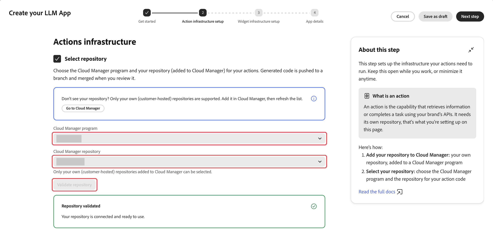

# 基盤の設定 {#create-first-app}

>[!IMPORTANT]
>
>LLM Appsは、AEM Sites Cloud Serviceのすべてのユーザーが独自のアプリケーションを開発および管理できます。 メーター設定が開始されると、各アプリ呼び出しは、お客様のAEM Sites コンテンツリクエストにカウントされます。 Adobeは、計量が有効になる前に、計量レートと開始日を発表します。

インフラストラクチャは、アプリの技術的な基盤です。コードを保存するリポジトリと、アクションハンドラーを実行し、ウィジェットをユーザーに配信するサービスです。

[概要](/help/overview/overview.md#key-concepts)で説明しているように、**アクションハンドラー**&#x200B;は製品の検索などのタスクを実行し、**ウィジェット**&#x200B;は会話のインタラクティブなエクスペリエンスとして結果を表示します。

[!DNL LLM Apps]は、ハンドラーとウィジェットのソースコードを2つの別々のリポジトリに保存します。

- **アクションリポジトリ** — サーバーサイドのハンドラーとそのテストを含みます。
- **ウィジェットリポジトリ** — インタラクティブウィジェットのコードとスタイルが含まれます。

たとえば、商品検索ハンドラーは一致する商品を取得し、そのウィジェットにはそれらを商品カードとして表示します。 リポジトリはそのコードを保存し、Adobe I/O Runtimeはデプロイされたハンドラーを実行し、Edge Delivery Servicesはウィジェットを提供します。

セットアップウィザードはこれらのリポジトリを準備し、アプリに必要なサービスを接続します。 次の2つのオプションのいずれかを選択します。

- **[!DNL LLM Apps]の管理インフラストラクチャ**&#x200B;が、最も早く開始できます。 Adobeでは、アクションハンドラーとウィジェットのリポジトリを作成およびホストするので、自分でリポジトリを設定する必要はありません。
- **独自のリポジトリ**&#x200B;は、アプリのコードを所有しているリポジトリに保存し、[!DNL Cloud Manager]に追加します。 [!DNL GitHub]、[!DNL GitHub Enterprise]、[!DNL GitLab]、[!DNL Bitbucket]または[!DNL Azure DevOps]でホストできます。 このプラットフォームは、必要なプロジェクトファイルを含む空のリポジトリを初期化するので、事前にアクションやウィジェットコードを準備する必要はありません。

**このガイドでは、** インフラストラクチャ オプションを選択し、セットアップ ウィザードを使用してアプリを作成する方法を説明します。 セットアップ後、[&#x200B; アクションの作成](/help/guides/creating-actions.md)に進みます。

アプリを作成すると、**not**&#x200B;がアクションの生成を開始します。 アプリページとは別にアクションの生成を開始します。

## アプリ作成ウィザードを開く

[Adobe LLM アプリ &#x200B;](https://experience.adobe.com/llm-apps)を開きます。 ようこそページから、**[!UICONTROL 開始]**&#x200B;を選択します。 既にアプリを開いている場合は、アプリセレクターを使用して、**[!UICONTROL 新しいアプリを作成]**&#x200B;を選択します。

**[!UICONTROL LLM アプリの作成]** ウィザードは、**[!UICONTROL 開始]**&#x200B;から始まります。 テクノロジー環境の設定方法を選択します。

| インフラオプション | ウィザードで選択 | テクノロジーの意味 |
|---|---|---|
| **[!DNL LLM Apps]の管理対象インフラストラクチャ** | **[!UICONTROL 処理しましょう]** | Adobeは、アプリのリポジトリと接続サービスを作成および管理します。 コードアクセスはリクエストに応じて利用できます。 |
| **自分のリポジトリ** | **[!UICONTROL Cloud Managerの設定を使用]** | [!DNL Cloud Manager]に追加された2つのリポジトリ （アクションハンドラー用とウィジェット用）を選択します。 プラットフォームは、空の場合にそれらを初期化します。 |

どちらのオプションも、後で自動アクション生成をサポートします。 どちらのオプションも、アクションを手動で記述する必要はありません。

## [!DNL LLM Apps]管理インフラストラクチャの使用 {#adobe-managed-infrastructure}

このオプションを使用すると、Adobeでアプリのリポジトリと接続サービスを設定および管理できます。 リポジトリを作成したり、[!DNL GitHub] アプリを自分でインストールしたりする必要はありません。

1. 「**[!UICONTROL 処理しましょう]**」を選択します。
2. **[!UICONTROL 次の手順]**&#x200B;を選択します。
3. [&#x200B; アプリの詳細](#app-details)を完了します。
4. 「**[!UICONTROL アプリを作成]**」を選択します。

アプリページには&#x200B;**[!UICONTROL アプリの設定]**&#x200B;が表示され、Adobeはリポジトリを準備し、ウィジェットサイトに接続します。 UIは、設定には通常1～2分かかることを示します。アクション、テスト、デプロイメントは、設定の準備ができるまで利用できません。

設定が失敗した場合は、エラーを読み取り、**[!UICONTROL 再試行]**&#x200B;を選択します。 ページで進行状況を確認できない場合は、バックグラウンドで設定を続行します。再接続するには、**[!UICONTROL もう一度チェック]**&#x200B;を選択します。

セットアップが完了したら、[&#x200B; アクションの作成](/help/guides/creating-actions.md)を続行します。

## 独自のリポジトリの使用 {#your-own-repositories}

「**[!UICONTROL Cloud Manager設定を使用]**」を選択してから、**[!UICONTROL 次の手順]**&#x200B;を選択します。 このパスには、次の4つのウィザード手順があります。

**アプリの詳細→ついて、アクション インフラストラクチャの設定→ウィジェット インフラストラクチャ→設定を開始します。**

[!DNL LLM Apps]は、Adobe アカウントを使用して[!DNL Cloud Manager]経由でリポジトリに到達します。 [!DNL GitHub] アプリはインストールできません。

### 始める前に {#own-repositories-prerequisites}

- アプリが属する[!DNL Cloud Manager] プログラムへのアクセス。
- アクションハンドラー用とウィジェット用の2つのリポジトリ。 空のリポジトリは問題ありません。これには、作成されたREADMEとそのGit ホストのみを含むリポジトリが含まれます。
- 両方のリポジトリ [がプライベートリポジトリとしてCloud Manager](https://experienceleague.adobe.com/en/docs/experience-manager-cloud-manager/content/managing-code/external-repositories)に追加され、所有権が検証され、ステータスは&#x200B;**準備完了**&#x200B;です。 [!DNL Cloud Manager]は書き込み可能である必要があります。読み取り専用アクセストークンだけでは不十分です。

自分がホストしているリポジトリのみが一覧表示されます。 [!DNL Cloud Manager]でAdobeによってホストされているリポジトリはサポートされていません。

#### ウィジェットリポジトリはEdge Delivery Services サイトです {#widget-repository-is-an-eds-site}

ウィジェットは[!DNL Edge Delivery Services] （EDS） サイトから提供され、ウィジェット リポジトリはそのサイトのコードを保持します。 ウィジェットリポジトリがEDS サイトに属しているか、またはが属していることを確認します。 1つを設定するには2つの方法があります。

- **任意のGit プロバイダーで、自分のGitを持ち込む。** [!DNL Cloud Manager]でEDS サイトを作成し、**自分のGitを持ち込む**&#x200B;でリポジトリにリンクします。 次に、[!DNL Cloud Manager]はリポジトリのコードをサイトに同期します。 ウィザードを開始する前に、これを行います。 [独自のGitを持ち込む](https://www.aem.live/developer/byo-git)を参照してください。
- **A [!DNL GitHub] リポジトリ、およびAEM Code Sync。** [Edge Delivery Services チュートリアル &#x200B;](https://www.aem.live/developer/tutorial)のように、自分でEDS サイトを設定します。 このウィザードでは、AEM Code Syncのインストールと、リポジトリの検証後のアクセス権の確認について説明します。

ウィジェットステップは、適用されるケースを検出します。 [&#x200B; ウィジェットインフラストラクチャの設定](#set-up-the-widget-infrastructure)を参照してください。

>[!TIP]
>
>会社が既にEDS サイトを持っている場合でも、[!DNL LLM Apps] ウィジェット用に別のEDS サイトを作成します。

>[!NOTE]
>
>空のリポジトリの場合、検証は初期プロジェクトファイルを書き込みます。 **[!UICONTROL リポジトリの検証]**&#x200B;を選択する前に、このアプリ用のリポジトリを選択してください。

### アクションインフラの設定

アクションリポジトリには、LLM プラットフォームがアクションを呼び出したときに実行されるサーバーサイドのハンドラーとテストが含まれます。

1. **[!UICONTROL Cloud Manager プログラム]**&#x200B;で、アクションリポジトリを含むプログラムを選択します。
2. **[!UICONTROL Cloud Manager リポジトリ]**&#x200B;で、アクションリポジトリを選択します。 見つからない場合は、**[!UICONTROL Cloud Manager]**&#x200B;に移動して[!DNL Cloud Manager]に追加し、リストを更新します。
3. 「**[!UICONTROL リポジトリを検証]**」を選択します。 検証により、Adobe LLM Apps ボイラープレートを使用して空のリポジトリが初期化されます。 既存のリポジトリには、互換性のあるアクションプロジェクトが含まれている必要があります。
4. **[!UICONTROL Repository validated]**&#x200B;が表示されたら、**[!UICONTROL 次の手順]**&#x200B;を選択します。

プラットフォームは、生成されたアクションコードをこのリポジトリのブランチにプッシュします。 **[!UICONTROL レビュー済みとしてマーク]**&#x200B;を選択すると、ブランチが結合されます。 [&#x200B; アクションの作成](/help/guides/creating-actions.md)を参照してください。

### ウィジェットインフラストラクチャの設定 {#set-up-the-widget-infrastructure}

ウィジェットとは、商品カードや予約フォームなどのアクションに添付される、オプションの視覚的な応答です。 Edge Delivery Services（EDS）は、ウィジェットリポジトリを使用するサイトからこれらを提供します。

1. **[!UICONTROL ウィジェットソース]**&#x200B;で、**[!UICONTROL ウィジェットリポジトリを手動で選択]**&#x200B;を選択します。

   

2. **[!UICONTROL Cloud Manager プログラム]**&#x200B;で、ウィジェットリポジトリを含むプログラムを選択します。 アクションリポジトリのプログラムとは異なる場合があります。
3. **[!UICONTROL Edge Delivery Services リポジトリ]**&#x200B;で、ウィジェットリポジトリを選択します。 アクションリポジトリは選択しないでください。
4. 「**[!UICONTROL リポジトリを検証]**」を選択します。 検証を実行すると、AEMのボイラープレートを使用して空のリポジトリが初期化されます。 既存のリポジトリは、互換性のあるEDS プロジェクトである必要があります。

次に何が起こるかは、ウィジェットリポジトリがホストされる場所によって異なります。

#### 別のプロバイダーのウィジェットリポジトリ（独自のGitを取り込む） {#widget-repository-byog}

[!DNL GitLab]、[!DNL Bitbucket]、[!DNL Azure DevOps]または[!DNL GitHub Enterprise]のリポジトリの場合、検証は、[!DNL Cloud Manager]がリポジトリにリンクしているEDS サイトを見つけます。 ウィザードに、**[!UICONTROL Edge Delivery Services サイト]**&#x200B;の下のサイトが表示されます。

が表示されました

[!DNL Cloud Manager]はリポジトリのコードをそのサイトに同期するので、AEM Code Syncは必要ありません。 **[!UICONTROL 次の手順]**&#x200B;を選択します。

検証でサイトがリンクされていないことが報告された場合は、リポジトリを[!DNL Cloud Manager]のEDS サイトに&#x200B;**自分のGitを取り込む**&#x200B;とリンクしてから、再度検証します。 [独自のGitを持ち込む](https://www.aem.live/developer/byo-git)を参照してください。

#### GitHub上のWidget リポジトリ {#widget-repository-github}

[!DNL GitHub] リポジトリは、AEM Code Syncを使用してコードを公開します。 検証後、ウィザードに&#x200B;**[!UICONTROL AEM Code Syncのインストール]**&#x200B;が表示されます。 [!DNL LLM Apps]、AEM サイト アクセス、およびDA書き込みアクセスに同じAdobe アカウントを使用します。

##### AEM サイトアクセスの設定 {#aem-site-access}

**新規インストール：** **[!UICONTROL AEM Code Sync]**&#x200B;をインストールし、ウィジェットリポジトリへのアクセス権を付与します。 インストール確認ページのセットアップウィザードを完了して、自分をサイト管理者として追加してください。

**既存のEDS サイト：** AEM Code Syncのインストールを維持し、選択したウィジェットリポジトリをカバーしていることを確認します。 既存のサイト管理者に対し、`https://tools.aem.live/tools/user-admin/index.html/?org=<org>&site=<site>`でAEM User Adminを開き、`admin`の役割でAdobe アカウントを追加するように依頼します。 Code Syncを再インストールする必要はありません。

`<org>`と`<site>`をAEMの組織名とサイト名に置き換えます。 サイト管理者は、これらの値を確認できます。

##### DA書き込みアクセス権の付与 {#da-write-access}

新規および既存のサイトの両方について、DA組織管理者に次のことを依頼します。

1. `https://da.live/config#/<org>/`でDA設定を開き、`<org>`をサイトのコンテンツを保存するDA組織に置き換えます。
2. **権限** シートを開きます。 存在しない場合は、**[!UICONTROL シートを追加]**&#x200B;を選択し、`permissions`という名前を付け、列ヘッダー&#x200B;**パス**、**グループ**、**アクション**&#x200B;を追加します。 **コメント**&#x200B;列を追加して、各ルールを説明することもできます。
3. サイト内のすべてのコンテンツに対するAdobe アカウントの書き込みアクセス権を付与する行を追加します。**パス**&#x200B;のサイトのコンテンツパス、**グループ**&#x200B;のAdobe アカウントの電子メール、および&#x200B;**アクション**&#x200B;の`write`を使用します。 設定を保存します。

   

   このスクリーンショットは架空のアカウントを使用しています。 `widget-author@example.com`をAdobe アカウントの電子メールに置き換え、組織全体の`/ + **`の例ではなく、サイトのコンテンツパスを使用します。 `CONFIG`行は構成管理者用です。コンテンツへのアクセス権を付与するために変更する必要はありません。

AEM サイトの役割は、DA書き込みアクセス権を付与しません。 組織全体の書き込みアクセス権は必要ありません。

DA権限の設定について詳しくは、[権限とセキュリティ &#x200B;](https://www.aem.live/docs/ew/administering/permissions)を参照してください。

##### AEM設定の検証 {#validate-aem-setup}

1. [!DNL LLM Apps]に戻り、**[!UICONTROL AEM設定の検証]**&#x200B;を選択します。
2. **[!UICONTROL AEM設定が確認されました]**&#x200B;が表示されたら、**[!UICONTROL 次の手順]**&#x200B;を選択します。

検証に失敗した場合は、メッセージに従って[AEM サイト アクセス &#x200B;](#aem-site-access)または[DA書き込みアクセス &#x200B;](#da-write-access)を確認し、もう一度検証します。

>[!NOTE]
>
>**[!UICONTROL Cloud Manager Edge Delivery Servicesの使用]**&#x200B;は&#x200B;**[!UICONTROL 近日リリース予定]**&#x200B;とマークされ、選択は許可されません。 manual widget-repository オプションを使用します。

## アプリの詳細を入力 {#app-details}

両方のインフラストラクチャ オプションは、**[!UICONTROL アプリの詳細]**&#x200B;で終わります。

1. **[!UICONTROL LLM アプリ名]**&#x200B;を入力します。 ブランドまたはエクスペリエンスを識別する名前（*Frescopa Coffee*&#x200B;など）を使用します。
2. アプリが属する&#x200B;**[!UICONTROL AEM プログラム]**&#x200B;を選択します。 1つのプログラムのみにアクセスできる場合、ウィザードはそのプログラムを自動的に選択します。 独自のリポジトリでは、プログラムはアクションリポジトリのプログラムであり、ここで変更することはできません。
3. **[!UICONTROL Application Insights データ領域]**&#x200B;で、**[!UICONTROL 米国（米国）]**&#x200B;または&#x200B;**[!UICONTROL 欧州（EU）]**&#x200B;を選択します。
4. 「**[!UICONTROL アプリを作成]**」を選択します。

>[!IMPORTANT]
>
>アプリの作成後に、AEM プログラムおよびApplication Insights データ領域を変更することはできません。 この領域によって、アプリのApplication Insights データの保存場所が決まります。

利用できるAEM プログラムがない場合は、管理者にアクセス権を依頼します。 プログラムの読み込みに失敗した場合は、「**[!UICONTROL プログラムの読み込みを再試行]**」を選択します。

ウィザードは、作成後にアプリページを開きます。 [!DNL LLM Apps]個の管理対象インフラストラクチャで、インフラストラクチャのセットアップが完了するのを待ってから続行してください。

後でリポジトリを確認するには、アプリの&#x200B;**[!UICONTROL 設定]**&#x200B;を開きます。 「**[!UICONTROL リポジトリ]**」セクションには、各リポジトリのプログラムと名前、および「自分のGitを取り込む」を使用するウィジェットリポジトリのEDS サイトとオリジンが表示されます。 アプリの作成後にリポジトリを変更することはできません。

Adobe LLM アプリ [!DNL GitHub] アプリで以前に作成されたアプリは、既存のリポジトリで引き続き使用できます。

## 次のトピック：アクションの作成

アプリにインフラストラクチャが追加されましたが、まだ生成されたアクションはありません。 [&#x200B; アクションの作成](/help/guides/creating-actions.md)を続行してweb サイトを分析するか、手動でのアクション作成を選択します。

アクションメタデータ、ハンドラー、ウィジェット、およびデプロイされたMCP サーバーの関係については、[&#x200B; アプリケーションの接続方法](/help/guides/app-architecture.md)を参照してください。
