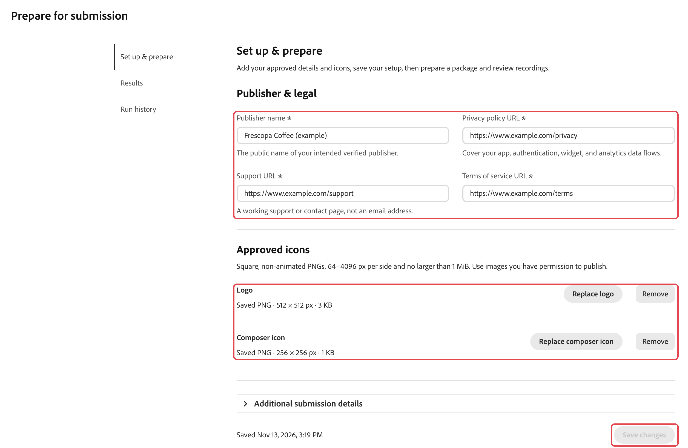
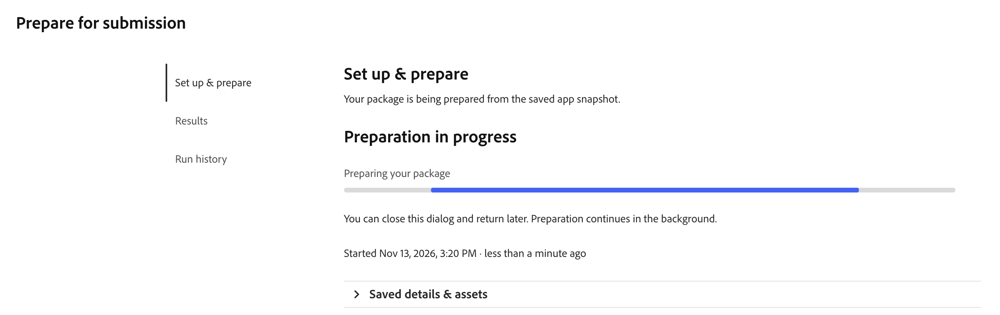

# ChatGPT送信用にアプリを準備する {#prepare-submission}

>[!IMPORTANT]
>
>LLM Appsは、AEM Sites Cloud Serviceのすべてのユーザーが独自のアプリケーションを開発および管理できます。 メーター設定が開始されると、各アプリ呼び出しは、お客様のAEM Sites コンテンツリクエストにカウントされます。 Adobeは、計量が有効になる前に、計量レートと開始日を発表します。

[!DNL ChatGPT] プラグインディレクトリにアプリを一覧表示するには、送信パッケージをOpenAIにアップロードします。 [!DNL LLM Apps]で準備できます。 アプリからパッケージ ZIPを作成し、デプロイされたアプリにテストリクエストを送信し、結果を記録して確認できるようにします。 次に、パッケージをアップロードし、OpenAI ポータルで送信を完了します。

**このガイドでは、** アプリの提出パッケージを[!DNL LLM Apps]で準備する方法と、OpenAI ポータルで次に行う操作について説明します。

>[!NOTE]
>
>[!DNL LLM Apps]さんはアプリをOpenAIに送信していません。 開発者とドメインの検証、接続テスト、レビュー、公開は、OpenAI ポータルでおこなわれます。 「[ プラグインをアップロードして送信する](https://developers.openai.com/plugins/deploy/submission)」を参照してください。

## 始める前に

- [ アプリをデプロイ ](/help/guides/deploy-your-app.md)して&#x200B;**本番**&#x200B;にデプロイします。 [!DNL LLM Apps]は、テスト要求をアプリの実稼動版に送信します。
- 公開するアクションがレビューされ、有効になっていることを確認します。
- パブリッシャー名、サポートページ、プライバシーポリシー、利用規約のURLを準備します。
- ロゴとコンポーザーアイコンの2つのアイコンを用意します。 各ピクセルは、正方形でアニメーション化されていないPNG、1辺あたり64 ～ 4096 ピクセル、1MiB以下である必要があります。 公開する権限のある画像のみを使用します。
- アプリ [がエンドユーザー](/help/guides/authentication.md)を認証する場合、ID プロバイダーが動的クライアント登録（DCR）またはクライアント ID メタデータ ドキュメント（CIMD）をサポートしていない限り、ID プロバイダーに[!DNL ChatGPT]のOAuth クライアントを登録します。

## 「送信用に準備」を開きます

アプリを実稼動環境に初めてデプロイすると、アプリページに「**[!UICONTROL 送信準備]**」カードが&#x200B;**[!UICONTROL アプリをテスト]**&#x200B;の下に表示されます。

「**[!UICONTROL 設定]**」を選択します。 その後、カードのボタンが変更され、**[!UICONTROL 進行状況の表示]**&#x200B;や&#x200B;**[!UICONTROL 結果の表示]**&#x200B;など、次のステップが表示されます。

**[!UICONTROL 送信準備]** ダイアログが開きます。 このセクションには、**[!UICONTROL セットアップと準備]**、**[!UICONTROL 結果]**、**[!UICONTROL 実行履歴]**&#x200B;の3つのセクションがあります。

## 送信の詳細を追加

**[!UICONTROL セットアップと準備]**&#x200B;で：

1. **[!UICONTROL Publisher &amp; legal]**&#x200B;で、**[!UICONTROL Publisher name]**、**[!UICONTROL Support URL]**、**[!UICONTROL Privacy policy URL]**、および&#x200B;**[!UICONTROL サービス利用規約URL]**&#x200B;を入力します。
   - **[!UICONTROL 発行者の名前]**&#x200B;に、OpenAI ポータルで発行者として確認する公開名を入力します。
   - **[!UICONTROL サポート URL]**&#x200B;の場合は、サポート ページまたは問い合わせページのURLを入力します。 メールアドレスが受け付けられません。
   - プライバシーポリシーは、アプリ、認証、ウィジェット、分析が収集して使用するデータを記述する必要があります。
2. **[!UICONTROL 承認済みアイコン]**&#x200B;の下で、**[!UICONTROL ロゴを選択]**&#x200B;してから&#x200B;**[!UICONTROL コンポーザーアイコンを選択]**&#x200B;し、それぞれに対してPNG ファイルを選択します。
3. アプリで認証を使用している場合は、**[!UICONTROL OAuth クライアント登録]**&#x200B;を開き、[!DNL ChatGPT]がOAuth クライアントを取得する方法を選択します。 ID プロバイダーがサポートしているオプションのみを選択します。
   - **[!UICONTROL 提供]** - [!DNL ChatGPT]のクライアントを登録しました。 **[!UICONTROL 登録済みクライアント ID]**&#x200B;を入力します。 Adobe IMSのクライアント IDは入力しないでください。
   - **[!UICONTROL DCR]** - [!DNL ChatGPT]は、動的クライアント登録を使用してクライアントを登録します。
   - **[!UICONTROL CIMD]** - [!DNL ChatGPT]は、クライアント ID メタデータ ドキュメントを使用して自分自身を識別します。

   [!DNL LLM Apps]はクライアントの秘密鍵を要求しません。
4. 必要に応じて、**[!UICONTROL 追加の提出の詳細]**&#x200B;を開き、リストテキスト、パッケージ名とバージョン、購入の詳細、ホストされているデモ URL、サポートされている国、リリースノートを入力します。 フィールドを空白のままにすると、[!DNL LLM Apps]は可能な場所にテキストをドラフトします。 ドラフトできないものは、後で&#x200B;**[!UICONTROL 送信前]**&#x200B;に表示されます。
5. **[!UICONTROL 変更を保存]**&#x200B;を選択します。

準備では、保存した詳細とアイコンのみを使用します。

>[!TIP]
>
>OpenAIのレビュー担当者は、理想的には[!DNL ChatGPT]に記録されたアプリのデモ動画を、開くことができるURLとともに必要としています。 [!DNL LLM Apps]からのテスト録画は自分自身のチェック用であり、このデモを置き換えるものではありません。 デモを記録し、レビュー担当者がアクセスできる場所にアップロードし、パッケージを準備する前に&#x200B;**[!UICONTROL ホストされているデモ URL]**&#x200B;にそのURLを入力します。

## パッケージの準備

**[!UICONTROL パッケージの準備]**&#x200B;で、**[!UICONTROL 準備状況]**&#x200B;を確認してください。 **[!UICONTROL 準備の準備完了]**&#x200B;とは、保存された詳細が要件を満たしていることを意味します。 それ以外の場合は、必要な詳細や実稼動環境のデプロイメントの成功など、欠落しているものをリスト表示します。

1. **[!UICONTROL 準備すると何が起こるか]**&#x200B;をお読みください。 [!DNL LLM Apps]はパッケージを作成し、デプロイされたアプリにテスト リクエストを送信します。 これには数分かかる場合があり、テストのリクエストがアプリの分析に表示されます。
2. 「**[!UICONTROL 」を選択します。これがデプロイされたアプリを呼び出して、レビューの証拠を準備することを理解しています。]** チェックボックス。
3. 「**[!UICONTROL パッケージを準備]**」を選択します。

準備中に、ダイアログに&#x200B;**[!UICONTROL 準備中]**&#x200B;と表示されます。 [!DNL LLM Apps]は、**[!UICONTROL パッケージの準備]**&#x200B;を選択した際と同じように、アプリと詳細を使用します。

ダイアログを閉じて、後で戻ることができます。 準備はバックグラウンドで続行され、アプリ ページのカードには、完了するまで&#x200B;**[!UICONTROL パッケージの準備]**&#x200B;が表示されます。 準備に失敗した場合、保存した詳細は保持されます。

## 結果を見る

準備が完了したら、**[!UICONTROL 結果]**&#x200B;を開きます。 セクションの上部には、結果がまとめられています。 **[!UICONTROL 準備に注意が必要]**&#x200B;とは、[!DNL LLM Apps]がドラフトパッケージを作成したが、最初に修正する必要がある問題（プレースホルダーの法的リンクなど）が見つかったことを意味します。

- **[!UICONTROL パッケージとレポート]** - **[!UICONTROL パッケージをダウンロード]**&#x200B;を選択して送信ZIPを取得し、**[!UICONTROL レポートをダウンロード]**&#x200B;して準備レポートを取得します。 **[!UICONTROL ダウンロードパッケージ]**&#x200B;は、準備によって完全なパッケージが生成される場合にのみ使用できます。
- **[!UICONTROL 録画を確認]** - **[!UICONTROL 録画をダウンロード]**&#x200B;を選択し、ビデオを視聴して、アプリが意図したとおりに動作することを確認します。 1つのビデオに複数のテストケースを含めることができます。
- **[!UICONTROL テストケース]** – 各テストケースについて、送信されたリクエストとそのステータスを確認します。 **[!UICONTROL 期待される動作]**&#x200B;を開いて、アプリが何をすべきかを確認します。 一部のテストケースでは、アプリでサポートされていない機能を求める場合があります。 これらの場合、アプリはアクションを呼び出さずにリクエストを辞退する必要があります。

録画は[!DNL LLM Apps] テスト環境から取得されます。 [!DNL ChatGPT]があなたのアプリを検証したか、OpenAIがそれを承認したわけではありません。

**[!UICONTROL 送信する前に、]**&#x200B;には、アプリに購入が含まれているかどうか、ホストされているデモ URL、サポートされている国、リリースノートなど、確認または入力が必要な詳細情報が一覧表示されます。 リストの下に、各チェックに&#x200B;**PASS**、**WARN**、**FAIL**&#x200B;が表示されます。 チェックを展開して詳細を確認します。 詳細を修正するには、**[!UICONTROL 詳細を更新]**&#x200B;を選択し、変更を保存して、パッケージを再度準備します。

準備後にアプリまたは詳細を変更した場合、**[!UICONTROL 結果]**&#x200B;には&#x200B;**[!UICONTROL アプリまたは入力がこの実行後に変更されたことが表示されます]**。 現在のアプリと詳細から新しいパッケージを作成するには、**[!UICONTROL もう一度準備]**&#x200B;を選択します。 **[!UICONTROL 実行履歴]**&#x200B;には、以前の準備が一覧表示されます。 1つを開いても、保存した詳細は変更されません。

## OpenAI ポータルで送信

パッケージが完了したら、それをダウンロードし、[OpenAI ドキュメントの](https://developers.openai.com/plugins/deploy/submission)をアップロードして送信します。

1. ZIP ファイルをアップロードして、自動チェックで検出された問題を修正します。
2. MCP サーバーを接続し、ドメインの検証を完了します。
3. アプリにログインが必要な場合は、レビュー担当者のログイン情報などのレビュー情報を入力し、アプリをレビュー用に送信します。
4. 承認済みプラグインを公開します。

ドメインを確認するには：

1. パッケージをアップロードしたら、OpenAI ポータルに表示されるチャレンジトークンをコピーします。
2. [!DNL LLM Apps]で、アプリの&#x200B;**[!UICONTROL 設定]** > **[!UICONTROL 送信]**&#x200B;を開きます。
3. **[!UICONTROL ドメイン検証]**&#x200B;で、トークンを&#x200B;**[!UICONTROL OpenAI チャレンジトークン]**&#x200B;に貼り付け、**[!UICONTROL 保存]**&#x200B;を選択します。
4. [ アプリを実稼動環境に再びデプロイします](/help/guides/deploy-your-app.md)。 トークンは、次のデプロイメントの後にのみ公開されます。
5. OpenAI ポータルに戻り、確認を完了します。

[!DNL LLM Apps]は、アプリのドメインの`/.well-known/openai-apps-challenge`でトークンを提供するので、自分でホストする必要はありません。

### レビューをスムーズに行うためのヒント

- **すべてのアクションの認証を確認します。** OpenAI ポータルがMCP サーバーをスキャンすると、すべてのアクションが呼び出されます。 アクションが「認証が必要」とマークされていても、呼び出しが認証できない場合、スキャンは失敗します。 次に、アプリを修正し、新しいパッケージを準備し、再度アップロードする必要があります。
- **レビューの時間を許可します。** 送信後、OpenAIはアプリを公開する前にレビューし、電子メールでフィードバックを送信します。 リリース日を計画する際は、この時間を考慮に入れてください。
- **リストの詳細が変更されたときに新しいパッケージをアップロードします。** 公開後、[!DNL ChatGPT]は、再デプロイ時にMCP サーバーへの変更を自動的に取得します。 リストの詳細またはその他のパッケージメタデータの変更には、新しいパッケージが必要です。 [!DNL LLM Apps]にもう一度準備し、OpenAI ポータルにアップロードします。

## 関連

- [アプリをデプロイ](/help/guides/deploy-your-app.md)
- [ChatGPT プラグインとしてLLM アプリをテストする](/help/guides/test-in-chatgpt.md)
- [ChatGPT拡張機能の設定](/help/guides/chatgpt-extensions.md)
